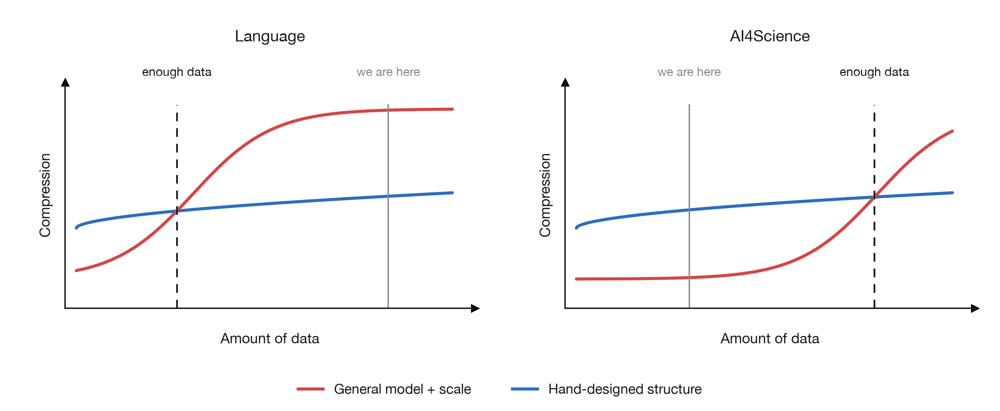
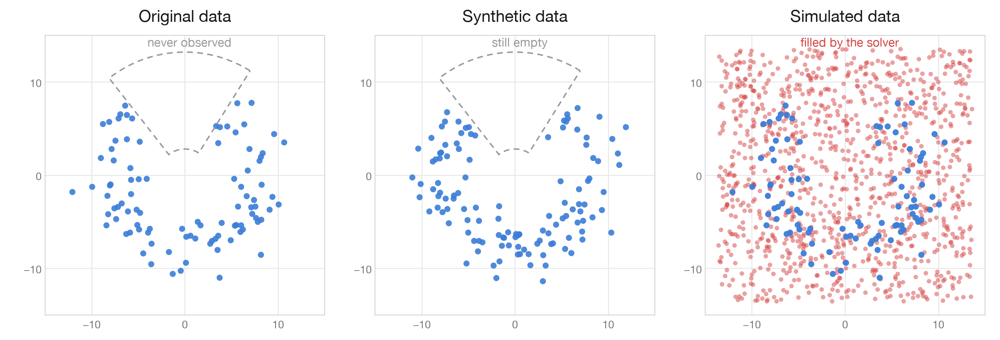

<nav>
  <a href="/">Home</a>
  <a href="/blog/">Blog</a>
  <a href="/publications/">Publications</a>
  <a href="/assets/files/CV_PJH.pdf">CV</a>
</nav>  

## Compromising with the bitter lesson: Designing how to search

 

  
  
Adapted from Lance's Blog. Compression here means how much data a model folds into its weights.

*"The biggest lesson that can be read from 70 years of AI research is that general methods that leverage computation are ultimately the most effective, and by a large margin. The ultimate reason for this is Moore's law, or rather its generalization of continued exponentially falling cost per unit of computation." - Richard Sutton* 

Scaling law, Bitter lesson both point toward the same point. The more data being compressed into the weights, the better the model becomes at being able to extrapolate to new data. Moreover, language modeling has shown that transductive inference emerges when *a) enough data is shown* and *b) the model becomes able at doing MCMC in gradient fields*.

But can *a)* and *b)* hold in other domains, particulary in domains that has no limit in it's information bound? (ex. CFD/FEM, Proteins, Physical Design) AlphaGo, AlphaFold and MuZero show that the path holds promise, but the question remains unproven whether this kind of success could be achieved in areas where data has not been fully opened yet.

This post will look over the computational complexity of these data, think about how to reduce the time and cost for collecting enough data for achieving scaling laws in AI4Science.

## Synthetic Data? Or Simulated Data (Solver-based)

 

  
  
Synthetic data is fitted to the original, so it inherits the same blind spots. A solver is bound by neither.

Traditional data augmentation methods - *SMOTE, ADASYN* and *Mixup* in machine learning, *random cropping* and *horizontal flipping* in computer vision - are a fixed family of transformations $f_1, \dots, f_k$ chosen in advance. Applied to a dataset $D = \lbrace x_1, \dots, x_N \rbrace$, they yield  $kN$ points, which lies in $\bigcup_{j=1}^{k} f_j(D)$ - a set already determined by the original data and the $k$ functions picked in advance. **The dataset grows by a constant factor, but its support does not.**

The bottleneck in this setting is that $f_1, \dots f_k$ is a **Hand-designed structure**, which introduces bias, going against the bitter-lesson which could lead to failure in Scaling. So the simple answer is make $f_\theta(x)$ ? Many Agentic Harness based synthetic data generation solves this via long chain-of-thought. The semantic power of LLMs enable them to make various functions, and by all means, may enable going beyond the bias of the original data if prompted to a right way.

<!-- But although Harness are compositional generalizers(dynamic $f_\theta$), a harness can only reach $\lbrace p_\theta(\cdot \mid D) : \theta \in \Theta \rbrace$, so $\inf_{\theta \in \Theta} \lVert p_\theta(\cdot \mid D) - p^\ast \rVert = \varepsilon > 0$ however many samples we draw. A solver does not approximate $p^\ast$ but evaluates the equations that define it, so its error is numerical.

However dynamic $f_\theta$ is, it builds everything from $D$: $I(\hat{D}; Y) \le I(D; Y)$, so no prompt adds information about the system $Y$ that $D$ never had. A solver escapes only by starting from the equations instead of $D$. -->

  $$I(\hat{D}; Y) \le I(D, C; Y)$$
  
$Y$ the field, $D$ our data, $C$ the training corpus, $\hat{D}$ what the harness generates.

But there lies a heavy assumption behind this dynamic $f_\theta$ via compositional generalizers(harness). Are these system capable of creating data where there is absolutely $0$ informaion about the field? Can LLMs make self-play-ish data? Or is it just a heavy computed version of the original data. And more importantly, can we distinguish between these two?

As we don't know for sure yet, we use solvers. The information gap reduces since agentic harness has a inference formula of $p_\theta(\cdot \mid D, C)$, and a solver has a approximation formula of $\hat{D} = f(Y, u)$, which eliminates the output space being restricted to both $D$ and $C$. But we should be careful since solvers are actually **Human-designed-formulars**. Or is it?

## But what is a solver anyway?

               
